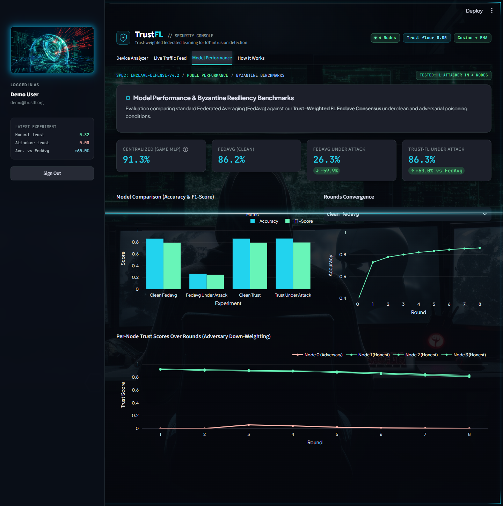

# TrustFL — Trust-Weighted Federated Learning for IoT Intrusion Detection

TrustFL is a research prototype that shows how **federated learning (FL)** can detect network
intrusions across several IoT networks **without sharing raw traffic**, and how a
**trust-weighted aggregation rule** keeps the shared model accurate even when one participant is
malicious.

It has three parts:

| Part | What it is | Where |
|---|---|---|
| **Experiment engine** | Simulates federated training with plain FedAvg and with the trust-weighted strategy, with and without a poisoning attacker | [`src/`](src) |
| **Dashboard** | A Streamlit security console: score an uploaded device's traffic, watch a live feed, browse the results | [`dashboard/`](dashboard) |
| **Documentation** | Method, code guide, limitations | [`docs/`](docs) |



## The problem

IoT devices — cameras, sensors, smart meters, medical monitors, industrial controllers — are
attacked constantly, and a good intrusion-detection model needs a lot of traffic from **many**
networks to learn what attacks look like. Getting that data together is hard:

- **Privacy and regulation.** Network traffic can reveal who is at home, what a factory produces or
  which patients are monitored. Companies and hospitals often cannot, or will not, hand it over.
- **Cost and ownership.** Moving large amounts of raw traffic to one place is expensive, and nobody
  wants to be the owner of everyone else's data.
- **A new weakness in the workaround.** *Federated learning* avoids sharing raw data by sharing only
  model updates. But the coordinating server cannot see the data, so it cannot check it. One
  compromised participant — a hacked gateway, a malicious insider or simply a faulty sensor — can
  send poisoned updates, and the usual averaging rule (FedAvg) trusts everyone equally. In this
  project's experiment **one bad node out of four dropped accuracy from 86 % to 26 %**, worse than
  guessing.

> **Problem statement:** How can several IoT networks jointly train an intrusion detector *without
> sharing their raw traffic*, and *without letting one compromised participant corrupt the shared
> model*?

## The solution

**Trust-weighted federated learning.** Networks keep their data and train locally, exactly as in
ordinary federated learning. The difference is on the server: instead of averaging every update
equally, it measures how well each participant's update agrees with the group, turns that into a
**trust score**, and lets trusted participants count for more and suspicious ones for almost nothing.

| Goal | How it is met |
|---|---|
| **Privacy** | Only model weights leave a network, never raw traffic |
| **Robustness** | An update that points against the group direction gets trust ≈ 0 and about 2 % of the vote instead of 25 % |
| **Low overhead** | No extra communication and no clean "reference" dataset needed — trust is computed from the updates alone |
| **No penalty when everyone is honest** | Clean trust-weighted accuracy matches plain FedAvg (86.2 % vs 86.2 %) |
| **Visibility** | A dashboard shows trust per node over time and can score a new device's data, plus audit its telemetry for faults |

Result: with one attacker out of four, trust-weighted aggregation keeps accuracy at **86.3 %** while
plain FedAvg falls to **26.3 %**. The method is explained step by step in
[docs/METHODOLOGY.md](docs/METHODOLOGY.md).

## Where it could be used

The idea fits any setting where several parties want a shared detector, cannot pool their data, and
cannot fully vouch for each other.

| Domain | Example scenario | Why this approach fits |
|---|---|---|
| **Smart-home / consumer IoT** | A vendor improves attack detection across thousands of customers' routers and cameras | Household traffic stays on the customer's network; one hacked device cannot poison the model for everyone |
| **Industrial IoT / smart factories** | Plants of different companies share knowledge about attacks on industrial controllers | Production data is confidential; a compromised site is a realistic threat |
| **Smart grid and utilities** | Substations and metering networks of several operators detect intrusions together | Operators are separate legal entities and critical-infrastructure data is sensitive |
| **Healthcare IoT** | Hospitals protect connected medical devices without exchanging patient-related traffic | Privacy rules restrict sharing; a faulty or hijacked device must not skew the model |
| **Smart cities and transport** | Municipalities, traffic cameras and connected-vehicle networks learn from each other | Many owners, many edge devices, limited trust between them |
| **ISPs and managed security providers** | A provider trains a detector across customer gateways | Customers will not share raw traffic, and some customer networks may already be compromised |

**Other uses of the pieces**

- **Admission check for a new participant:** the Device Analyzer scores whether a newly joining
  device's data looks like the healthy group *before* it is allowed into the federation.
- **Telemetry quality audit:** the data-audit step flags clock skew, counter underflow, duplicates
  and missing values in device captures, which is useful on its own.
- **Research and teaching testbed:** a small, reproducible setup for studying poisoning attacks and
  defences in federated learning.
- **Beyond intrusion detection:** the aggregation rule does not depend on the task, so the same idea
  applies to other federated problems with unreliable participants (for example cross-bank fraud
  detection) — but that would need to be validated, not assumed.

> These are intended application areas, not deployments. This repository is a simulation on
> synthetic data; a real system would additionally need secure transport, participant
> authentication, real traffic data and evaluation against stronger attackers. See
> [docs/LIMITATIONS_AND_FUTURE_WORK.md](docs/LIMITATIONS_AND_FUTURE_WORK.md).

## The result in one table

Four simulated IoT networks, 8 federated rounds. In the "under attack" runs, node 0 flips **all**
of its training labels and multiplies its model update by 4 (a "model replacement" attack).

| Run | Accuracy | F1 |
|---|---|---|
| Centralized MLP (no federation, upper reference) | 91.3 % | 0.872 |
| FedAvg, clean | 86.2 % | 0.791 |
| **FedAvg, under attack** | **26.3 %** | 0.248 |
| Trust-weighted, clean | 86.2 % | 0.792 |
| **Trust-weighted, under attack** | **86.3 %** | 0.796 |

In the trust-weighted attack run the attacker's trust score is **never above 0.06** (exactly 0.00 in
rounds 1–2, 0.003 by round 8), while honest nodes stay between 0.81 and 0.93. The numbers come from a single run with a fixed seed — see
[Limitations](docs/LIMITATIONS_AND_FUTURE_WORK.md) before quoting them as a general result.

## How the defence works (30 seconds)

1. Each round, every node trains locally and sends back its new model weights.
2. The server turns each node's *update* (new weights − old global weights) into a direction and
   computes the **consensus direction** — the average of all nodes' unit-length updates.
3. A node's **trust** is how well its update points the same way as the consensus
   (cosine similarity, clipped at 0), smoothed over rounds with an exponential moving average.
4. The server averages the nodes' weights using `trust × number_of_examples`, with a small
   floor (0.05) so nobody is silenced completely.

A poisoned node points in the opposite direction, gets trust ≈ 0, and contributes ≈ 2 % of the
aggregate instead of 25 %. Full details: [docs/METHODOLOGY.md](docs/METHODOLOGY.md).

## Quick start

Requires **Python 3.12** (tested on Windows 11; Python 3.13/3.14 on Windows cannot run the simulation, see below). Installing Flower with its simulation extra pulls in
Ray, so the first install takes several minutes.

```powershell
# 1. Create an environment and install the tested dependency versions
python -m venv .venv
.venv\Scripts\Activate.ps1
pip install -r requirements.txt          # or: pip install -r requirements.lock.txt  (exact versions)

# 2. Run the tests
python -m pytest tests

# 3. Train the baselines and run the full comparison (several minutes)
python src/baseline_model.py
python src/run_experiment.py --suite

# 4. Launch the dashboard
streamlit run dashboard/app.py          # opens http://localhost:8501
```

Dashboard demo login: `demo@trustfl.org` / `TrustFL@2026`
(created automatically on first launch; you can also create your own account).

macOS / Linux: the same commands work; activate with `source .venv/bin/activate`.

> **Fresh clone on another machine?** The `.venv` folder is not in git, so run steps 1–2 first and
> make sure the environment is **activated** before running anything. Seeing
> `Exit Code: 701 … Extra dependencies required for simulation are missing` means Ray is not
> installed in the Python you used — activate the venv and run `pip install -r requirements.txt`.
> **Use Python 3.12** — on Windows, Flower's simulation extra does not install Ray for Python 3.13/3.14
> (check with `python --version`; install 3.12 and create the venv with `py -3.12 -m venv .venv`). Flower prints two harmless warnings (`run_simulation is deprecated`,
> `Ray support on Windows is experimental`); on Windows, WSL2 is Flower's preferred setup.

The repository already contains generated results (`results/`) and the synthetic dataset
(`data/raw/`), so steps 3 can be skipped if you only want to look at the dashboard.

## Common commands

```powershell
python data/generate_synthetic_data.py                    # regenerate the synthetic dataset
python data/partition_data.py                             # write IID / non-IID node CSVs (optional)
python src/run_experiment.py --strategy fedavg --partition iid
python src/run_experiment.py --strategy trust  --partition iid --poison-node 0 --poison-fraction 1.0
python src/run_experiment.py --suite --rounds 8           # the four-run comparison + dashboard artefacts
```

All flags are listed in the [project guide](docs/PROJECT_GUIDE.md#run_experimentpy).

## Documentation map

| Document | Read it to … |
|---|---|
| [docs/PROJECT_GUIDE.md](docs/PROJECT_GUIDE.md) | Understand **everything**: every file, every function, data formats, data flow, how to extend it |
| [docs/METHODOLOGY.md](docs/METHODOLOGY.md) | Understand the algorithm, threat model, experimental setup and results (paper-style) |
| [docs/DASHBOARD_GUIDE.md](docs/DASHBOARD_GUIDE.md) | Use the dashboard: tabs, scenarios, CSV format, how verdicts are computed |
| [docs/LIMITATIONS_AND_FUTURE_WORK.md](docs/LIMITATIONS_AND_FUTURE_WORK.md) | Know what the results do and do **not** show, and what to do next |
| [CONTRIBUTING.md](CONTRIBUTING.md) | Contribute: workflow, interface contract, testing, style |

## Repository layout

```
trust-flow-dashboard/
├── src/                     experiment engine (federated learning, trust strategy)
├── dashboard/               Streamlit app + helpers (auth, data audit, scoring)
├── data/                    synthetic data generator, partitioner, raw data, sample device CSVs
├── results/                 generated outputs the dashboard reads (metrics + trained model)
├── tests/                   pytest suite
├── docs/                    documentation and screenshots
├── .streamlit/config.toml   dashboard theme
├── requirements.txt         dependencies (minimum versions)
└── requirements.lock.txt    exact versions the results were produced with
```

## Status and honesty note

This is a **simulation on synthetic data**. Nodes are simulated in one process; there is no network
transport, authentication or encryption between nodes, and the dataset is generated, not captured
traffic. The project demonstrates the *aggregation idea*; it is not a deployable IDS.
