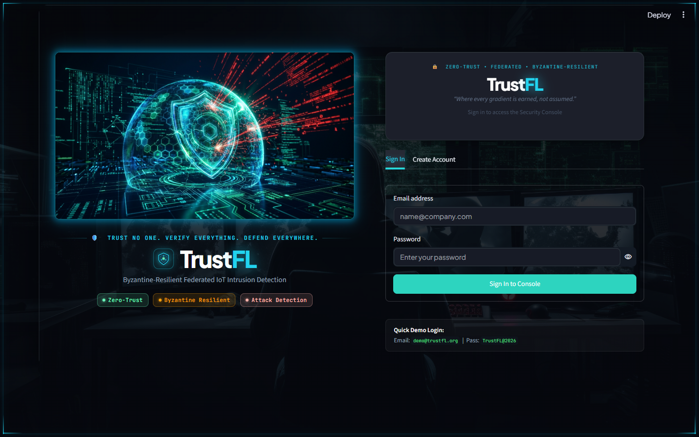
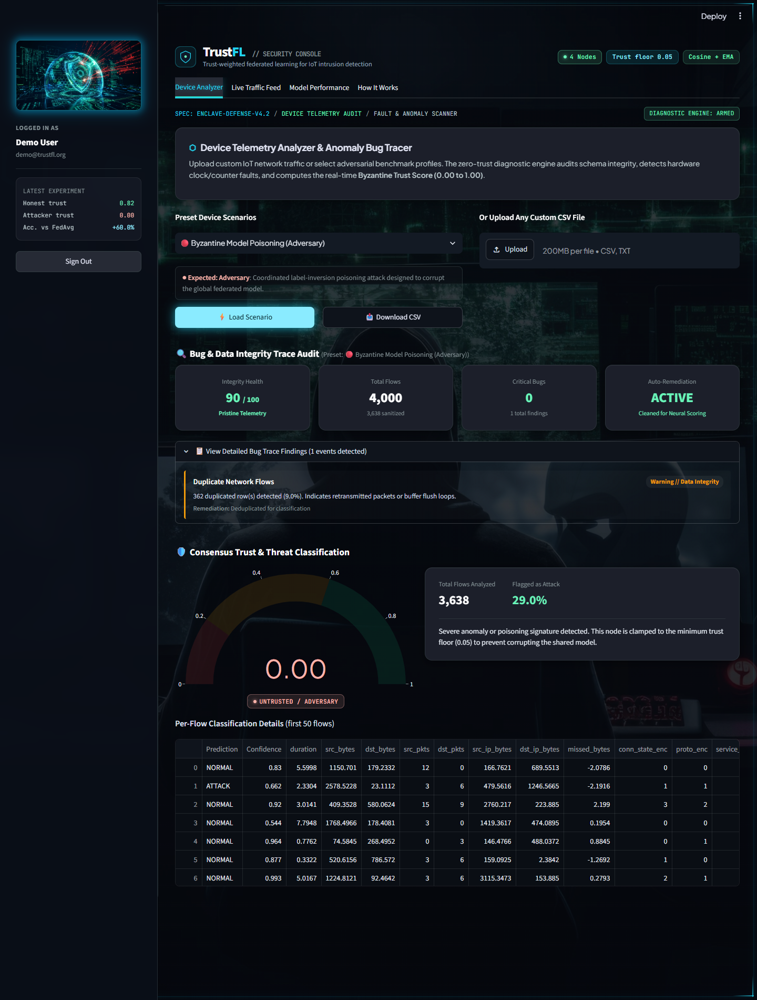
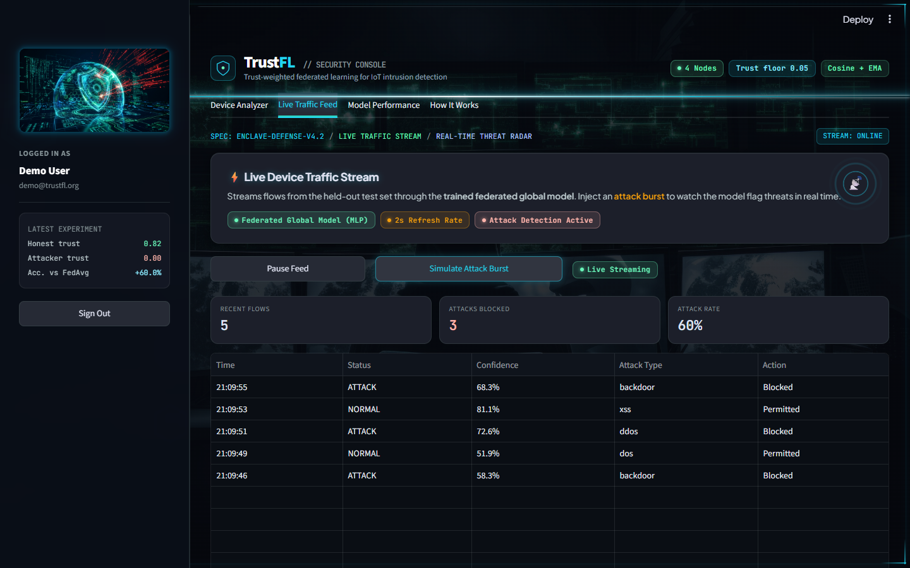
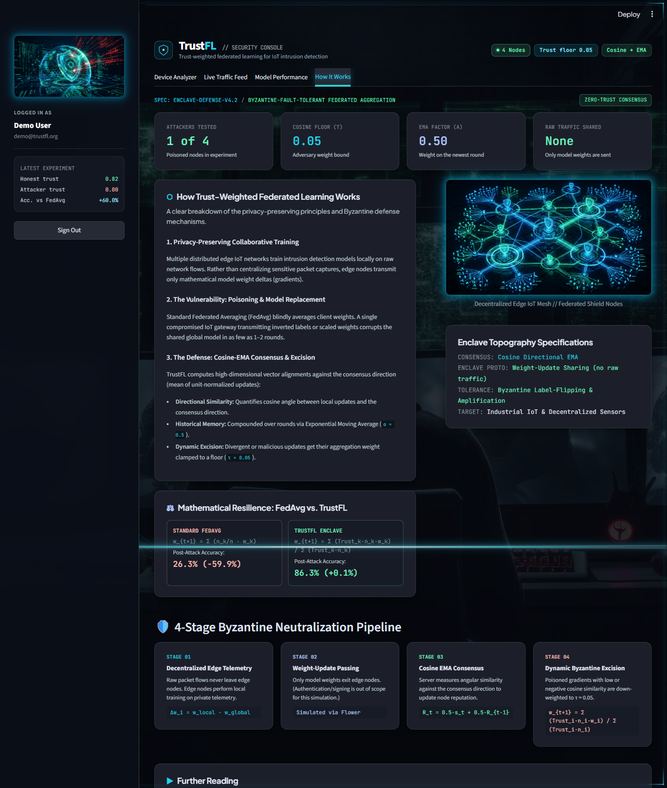

# Dashboard User Guide

A walkthrough of the TrustFL Security Console for someone using it, not developing it. For how it
is built see [PROJECT_GUIDE.md §7](PROJECT_GUIDE.md#7-the-dashboard-dashboard).

## Starting it

```powershell
.venv\Scripts\Activate.ps1
streamlit run dashboard/app.py        # then open http://localhost:8501
```

The dashboard reads files from `results/`. If they are missing, the affected tabs show a message
telling you to run `python src/run_experiment.py --suite` first.

## Signing in



- **Demo account:** `demo@trustfl.org` / `TrustFL@2026` (created automatically on first launch).
- **Create Account:** any e-mail, a password of at least 6 characters and at most 72 bytes.
  Accounts are stored in `dashboard/users.json` (bcrypt-hashed, git-ignored) on the machine running
  the dashboard. There is no e-mail verification and no password reset.
- Accounts from before the bcrypt upgrade no longer work — sign up again.

## The screen layout

- **Header:** project name, number of nodes in the saved experiment, trust floor and the method.
- **Sidebar → "Latest experiment":** three real numbers from the saved results — the honest nodes'
  mean trust and the attacker's trust in the final round, and the accuracy gained over FedAvg under
  attack. If no results exist it says so instead.
- **Tabs:** Device Analyzer · Live Traffic Feed · Model Performance · How It Works.

## Tab 1 — Device Analyzer



**Purpose:** answer *"if this device were a federated participant, would the group trust it?"*

**Inputs:** choose a **preset scenario** and press *Load Scenario*, or **upload your own CSV**
(up to 200 MB). *Download CSV* gives you the preset file.

| Preset | What it is | Expected verdict |
|---|---|---|
| Clean IoT Edge Node | Healthy traffic | Trusted |
| Stealth Recon & Port Scan | Low-and-slow scanning mix | Suspicious |
| Volumetric DDoS Surge | ~70 % attack flows | Suspicious |
| Byzantine Model Poisoning | Inverted/poisoned labels | Untrusted / Adversary |
| Unlabeled Wild Capture | No label column | Labels missing (no trust score) |
| Corrupted Telemetry | Negative durations, NaNs, duplicates | Bug report; scored after cleaning |
| Benchmark Clean / Poisoned | Reference slices | Trusted / Untrusted |

**What you get, top to bottom**

1. **Bug & Data Integrity Trace Audit** — four tiles: *Integrity Health* (0–100), *Total Flows*
   (with how many remain after cleaning), *Critical Bugs*, and *Auto-Remediation*. The expandable
   list gives each finding with severity, details and the fix that was applied.
2. **Consensus Trust & Threat Classification** — a gauge from 0 to 1 and a verdict badge, the
   number of flows analysed, the share **flagged as attack** by the federated model, and a
   plain-language explanation.
3. **Per-flow table** — the first 50 cleaned flows with the model's prediction (ATTACK / NORMAL)
   and its confidence.

**How the verdict is decided**

| Trust score | Verdict |
|---|---|
| > 0.60 | TRUSTED DEVICE |
| 0.20 – 0.60 | SUSPICIOUS ACTIVITY |
| ≤ 0.20 | UNTRUSTED / ADVERSARY |
| no `label` column | LABELS MISSING (per-flow predictions still shown) |

The trust score trains a copy of the saved global model for 2 epochs on **your labelled flows** and
measures how well the resulting update lines up with the group's healthy consensus direction. A
device whose labels contradict what the global model learned (poisoning) produces an update that
points the other way and scores about 0. **This needs labels** — it measures the device's *data and
labels*, not whether individual flows are malicious.

**Preparing your own CSV**

- Required: the 16 feature columns (see [PROJECT_GUIDE §5.1](PROJECT_GUIDE.md#51-schema)).
  Common alternative names are renamed automatically (`flow_duration`, `tot_fwd_pkts`,
  `bytes_sent`, `protocol`, …). Header case, spaces and hyphens do not matter.
- Optional: a `label` column (0/1, or text such as `normal`/`benign` vs anything else) for the trust
  score, and an `attack_type` column for the DoS/scan checks.
- Any feature column that is missing is **filled with 0** and listed in an *Info* finding. If many
  features are missing the verdict is not meaningful — the model was trained on 16 real columns.
- Cells that are not numbers are treated as missing and reported.

**What is not stored:** uploaded data lives only in your browser session and is not saved or used to
retrain anything.

## Tab 2 — Live Traffic Feed



A simulated stream, useful for demonstrating the model.

- **Start Live Feed / Pause Feed** — every 2 seconds one flow is drawn from the held-out test set,
  classified by the **trained federated global model**, and added to the log (newest first, last 25
  kept). Normal flows are shown as *Permitted*, attacks as *Blocked*.
- **Simulate Attack Burst** — the next 5 flows are forced to be attacks and the feed starts if it
  was paused.
- **Tiles:** recent flows, attacks blocked, attack rate (over the 25 shown).
- Note: the data is replayed from a test set, not captured live, and "Blocked" is a label only.

## Tab 3 — Model Performance


- **Four KPI tiles:** centralized MLP (no federation), FedAvg clean, FedAvg under attack (with the
  drop vs clean), and Trust-FL under attack (with the gain vs FedAvg under attack).
- **Model Comparison:** accuracy and F1 for the four suite runs.
- **Rounds Convergence:** pick a run to see accuracy per round. Round 0 is the untrained model.
- **Per-Node Trust Scores Over Rounds:** one line per node from the trust-weighted run. In an attack
  run the attacker (node 0) is drawn in red and falls to ≈ 0 while honest nodes stay high.
- The badge shows how many attackers were tested (1 in 4 nodes) — that is the tested setting, not a
  proven tolerance limit.

All values come from `results/comparison.json` and `results/baseline_results.json`; re-run the suite
and reload the page to update them.

## Tab 4 — How It Works



An explanation of the method (privacy-preserving training, the weakness of plain averaging, the
cosine-EMA defence), the FedAvg vs TrustFL result taken from your saved experiment, a four-stage
pipeline summary and further reading. The same story, with formulas and real numbers, is in
[METHODOLOGY.md](METHODOLOGY.md).

## Tips and limits

- Results change only when you re-run `run_experiment.py`; the dashboard never trains the global
  model.
- The verdict bands (0.20 / 0.60) are fixed values chosen from the sample files; in other settings
  absolute trust levels differ (honest trust drifts down as training converges).
- The login system is a demo-grade local user file, not a production identity system.
- Keep the 200 MB upload limit in mind; scoring trains on the whole file, so very large files are slow.
